# Demo

Optagelse af hele flowet i den nuværende app (designmanual, officielt logo, onboarding-test, board builder og CMS) med mock-leverandører for betaling, video og transskribering. Varighed ca. 2 min. 30 s, 1440x900.

Video i fuld opløsning: [demo.mp4](demo.mp4) (H.264, yuv420p, faststart)

| Trin | |
|---|---|
| 1. Forside og prisberegner med «fra»-priser | 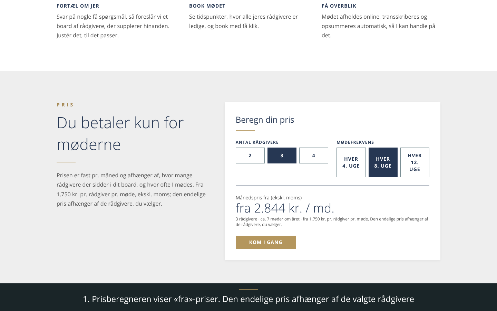 |
| 2. Trin 3: virksomhedskort fra CVR-registret | 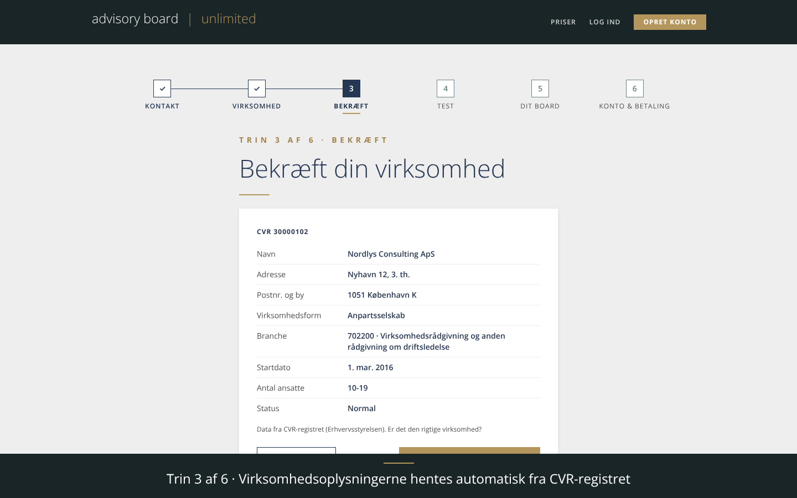 |
| 3. Trin 4: testen, ét spørgsmål ad gangen | 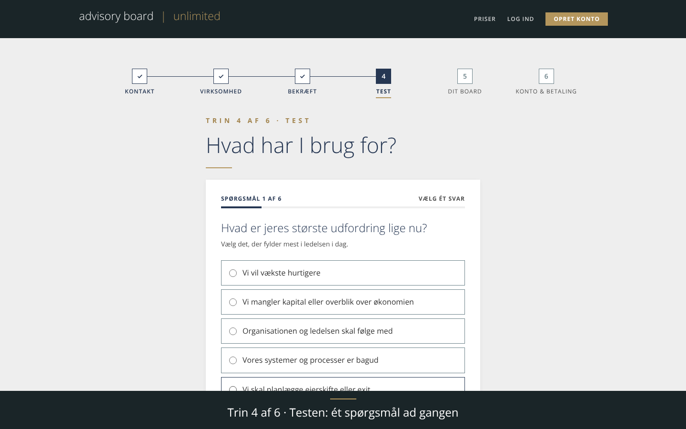 |
| 4. Trin 5: foreslået board med tags, dækning, frekvens og pris; udskiftning fra kataloget | 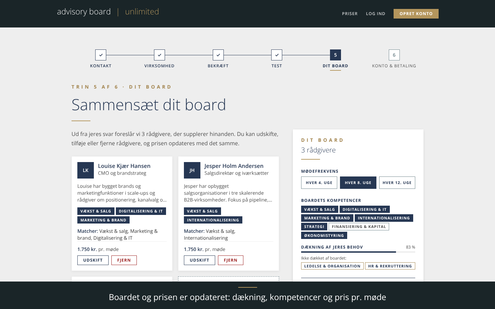 |
| 5. Trin 6: konto, samtykke og resumé; mock-betaling og dashboard | 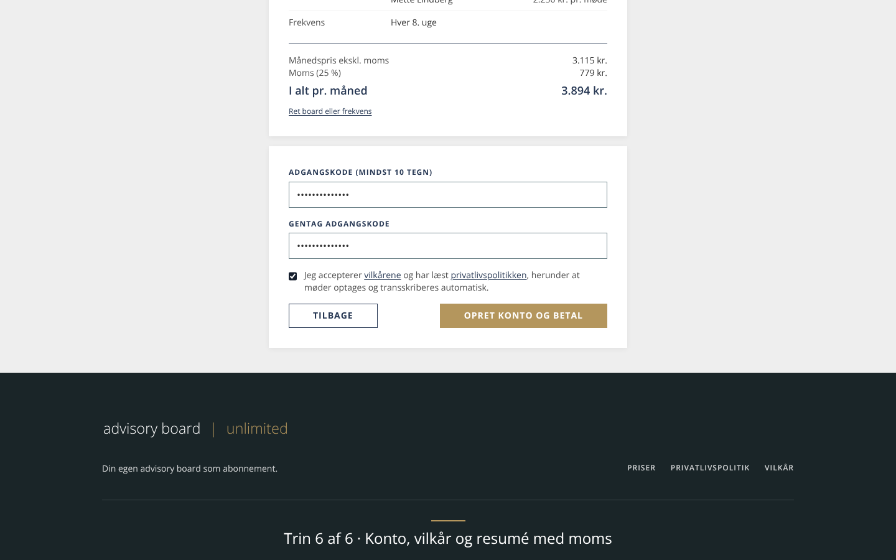 |
| 6. Kunden booker et møde i ugevisningen | 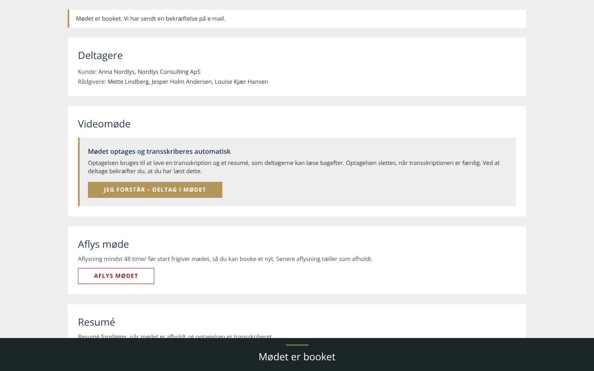 |
| 7. Rådgiveren viser tilgængelighed | 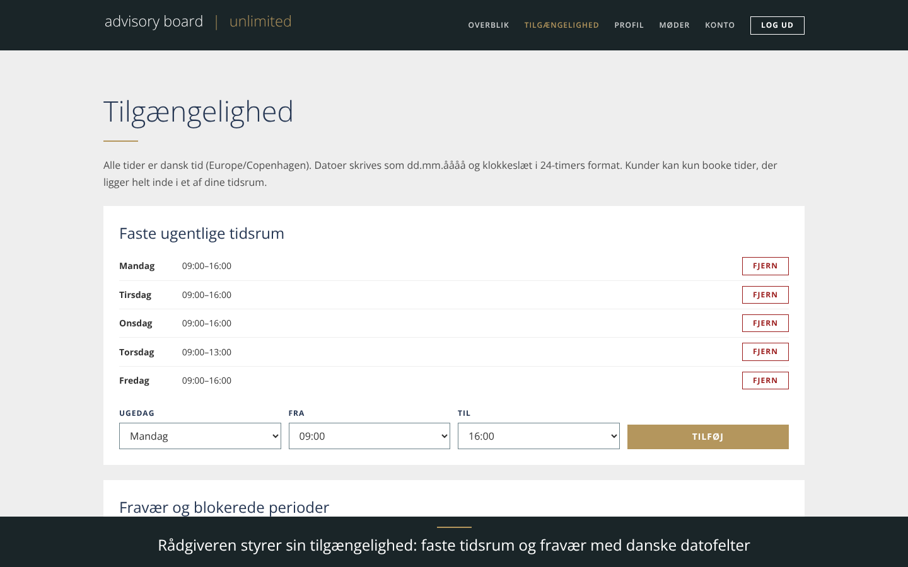 |
| 8. Rådgiverens møder | 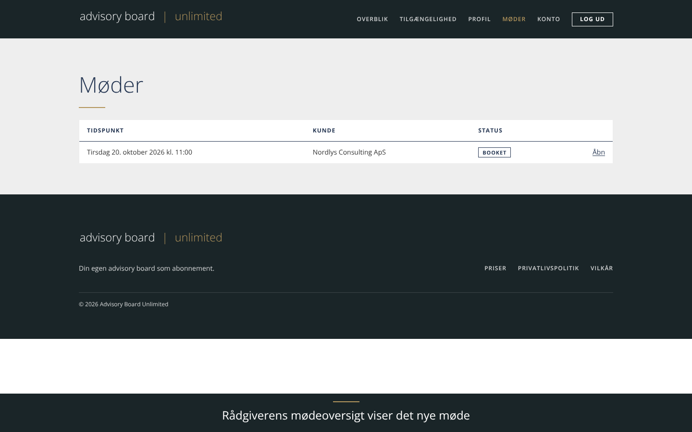 |
| 9. Afholdt møde med optagelse: transskription og resumé | 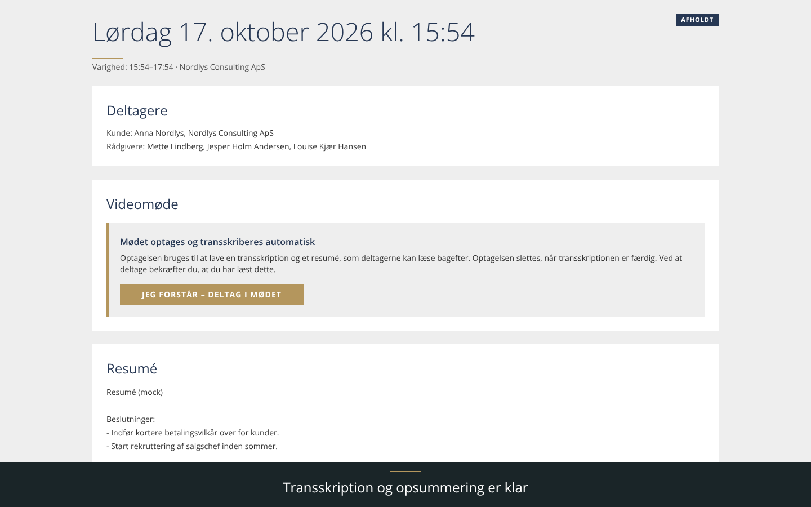 |
| 10. Admin-CMS: forhåndsvisning med foreslået board efter ændret tag-vægt | 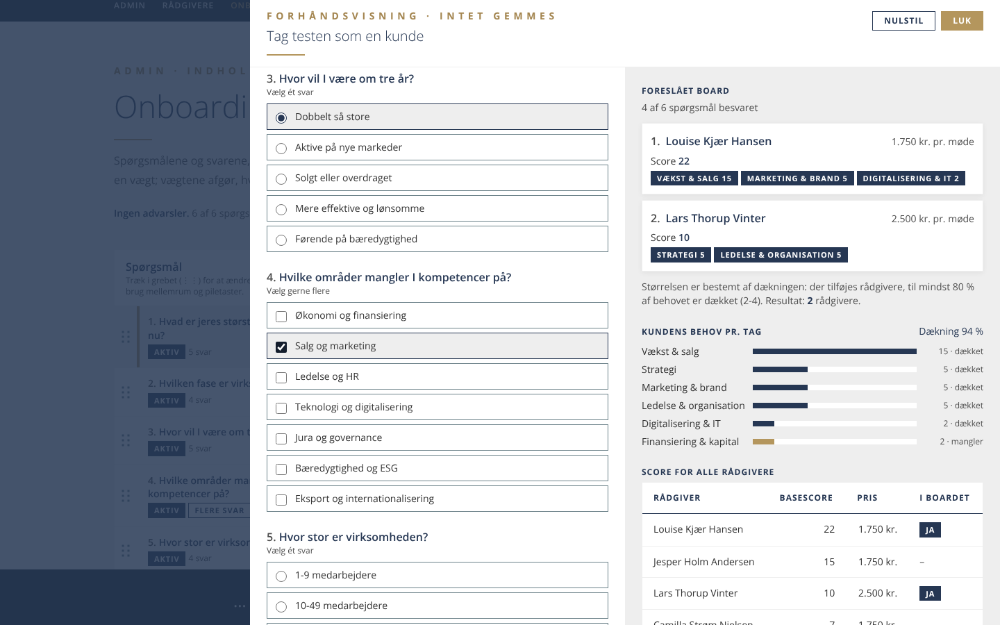 |
| 11. Admin-CMS: omrokering af spørgsmål med træk-grebet | 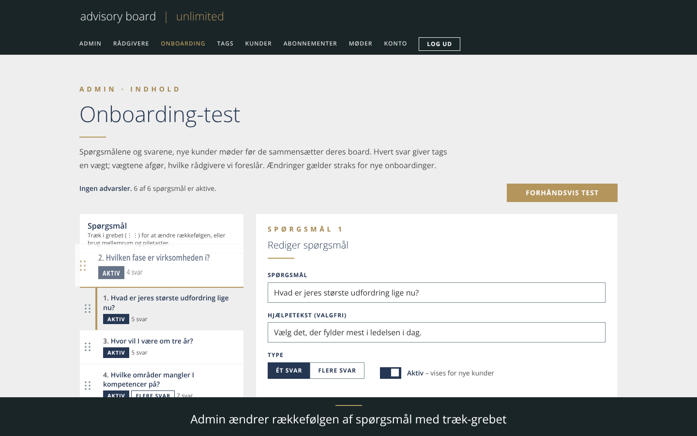 |
| 12. Admin sætter en rådgivers pris | 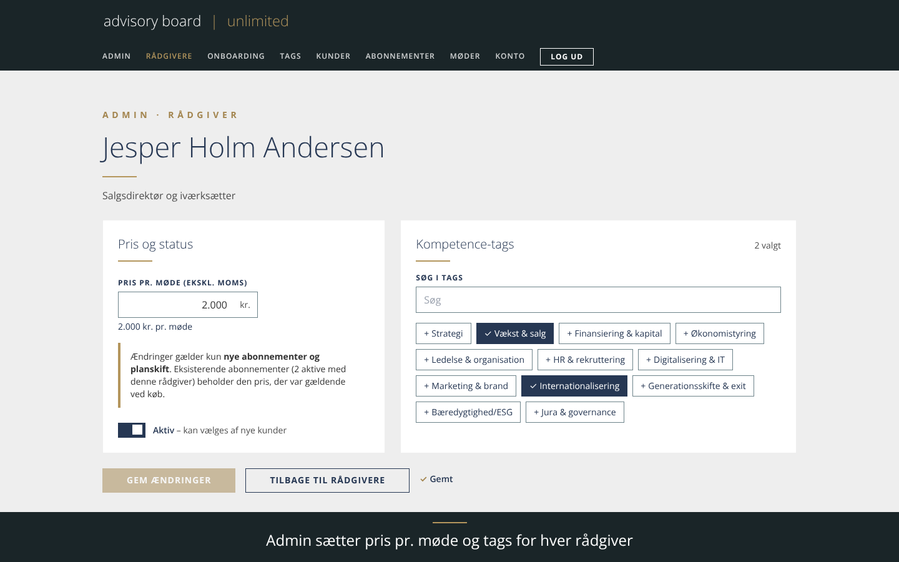 |

Optagelsen er lavet med Playwright mod en frisk database (seed) og `next start`. Et møde sættes i fortiden via SQL, før optagelsen uploades.
