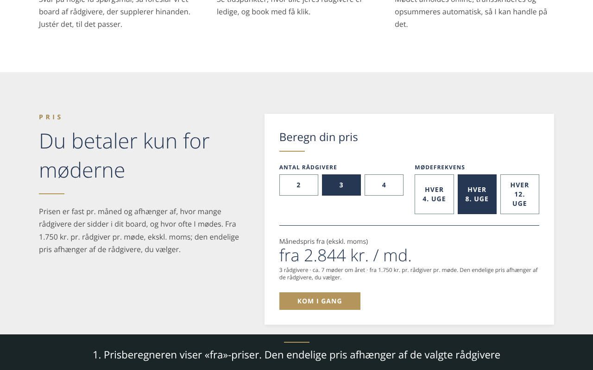
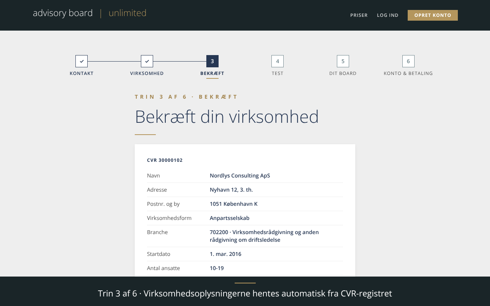
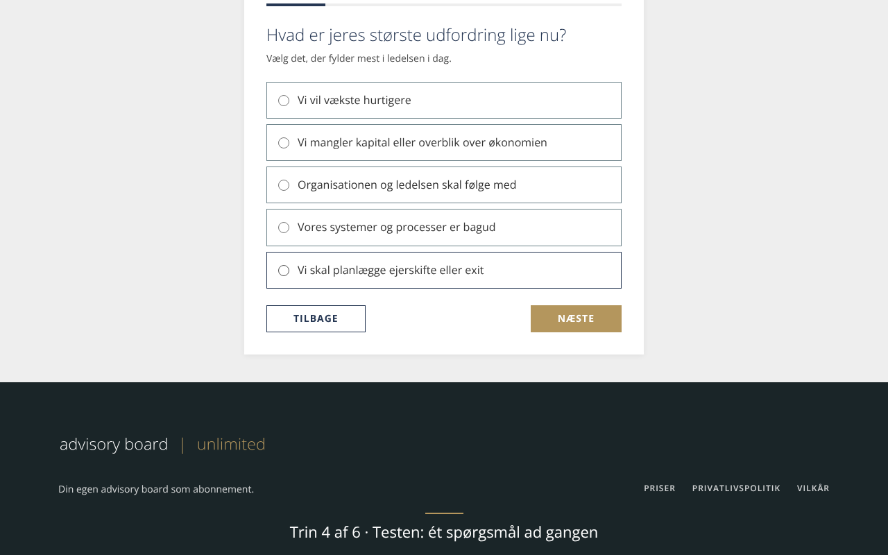
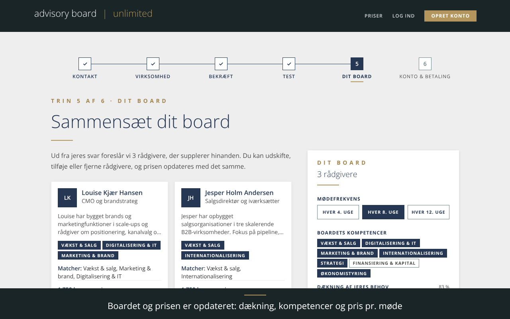
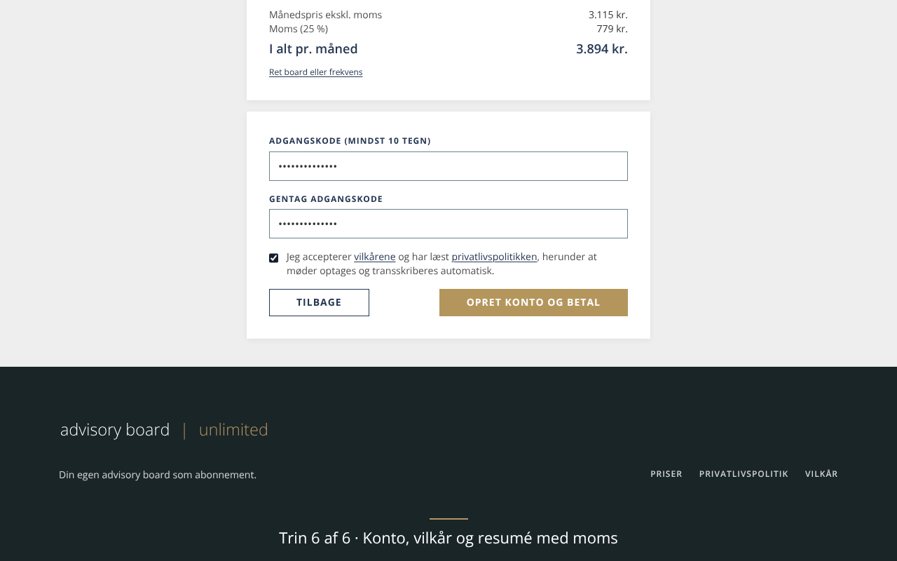
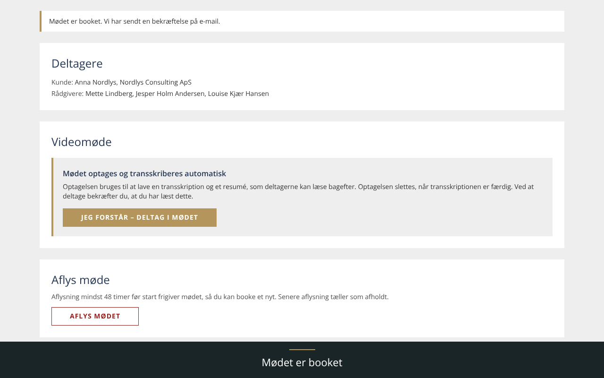
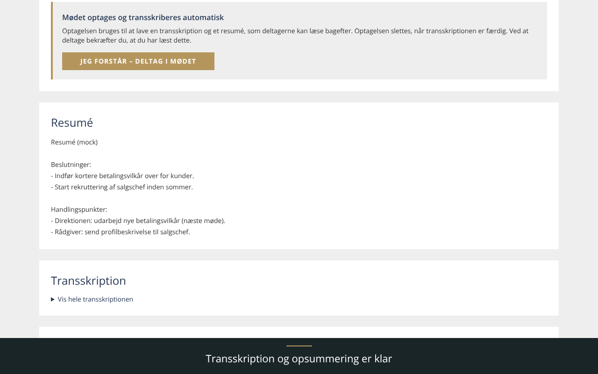
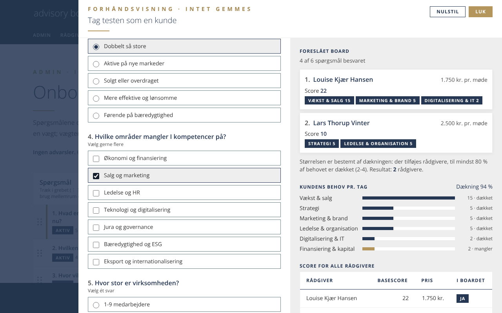

# Demo

Optagelse af hovedflowet med den nye onboarding (designmanual v1.2, officielt logo) og mock-leverandører (betaling, video og transskribering er simuleret). Varighed ca. 2 min.

Video i fuld opløsning: [demo.mp4](demo.mp4)

| Trin | |
|---|---|
| 1. Forside og prisberegner med «fra»-priser |  |
| 2. Onboarding trin 3: virksomhedsoplysninger hentet fra CVR-registret |  |
| 3. Onboarding trin 4: testen, ét spørgsmål ad gangen |  |
| 4. Trin 5: foreslået board, frekvens- og rådgiverskift med live pris |  |
| 5. Trin 6: konto, vilkår og resumé inkl. moms (mock-betaling aktiverer direkte) |  |
| 6. Kunden booker et møde i ugevisningen |  |
| 7. Admin uploader optagelse; transskription og resumé |  |
| 8. Admin-CMS: ændr tag-vægt og se forslaget ændre sig i forhåndsvisningen |  |

Optagelsen er lavet med Playwright mod en frisk database (seed) og `next start`.
